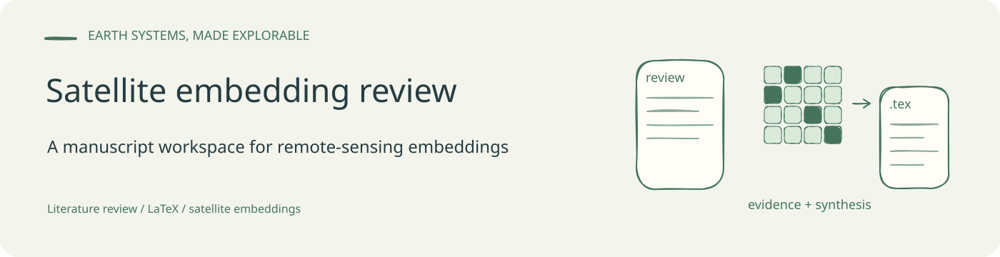
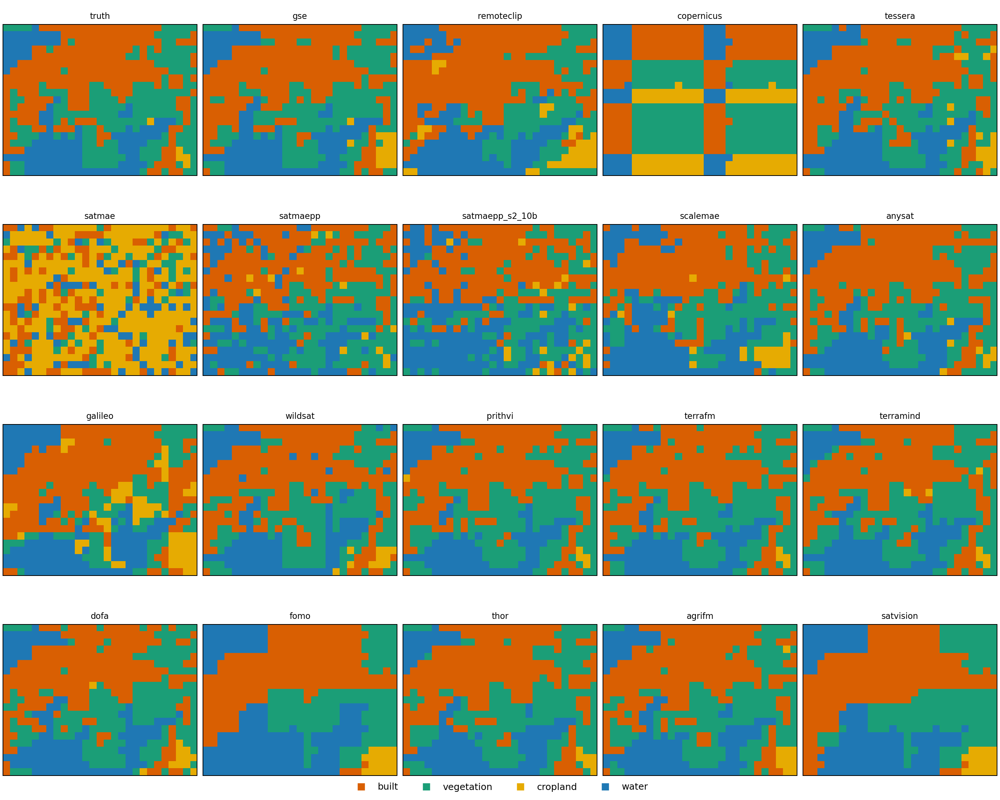

<!-- readme-visual-refresh:banner -->

<!-- /readme-visual-refresh:banner -->

Satellite Embedding: A Review
=============================

Overleaf entry point: main.tex

Compiled reference PDF: main_leaflet.pdf

Overleaf upload zip: rs-embed-review-overleaf.zip

This repository contains the LaTeX source, bibliography, tables, and figures required to compile the review manuscript.

<!-- readme-visual-refresh:artwork-source -->
[Editable banner artwork · Excalidraw](assets/readme/banner.excalidraw)
<!-- /readme-visual-refresh:artwork-source -->

<!-- readme-visual-refresh:selected-result -->

## 已有结果展示

已有武汉分类对照图：真实类别与多个遥感嵌入模型的分类地图，颜色区分建成区、植被、农田和水体。 该图为仓库已有成果，保留原有来源；本次仅整理展示，未重新运行。 [查看来源](https://github.com/GISWLH/rs-embed-review/blob/main/figures/fig12_wuhan_2x_classification_maps.png)。

<!-- /readme-visual-refresh:selected-result -->
